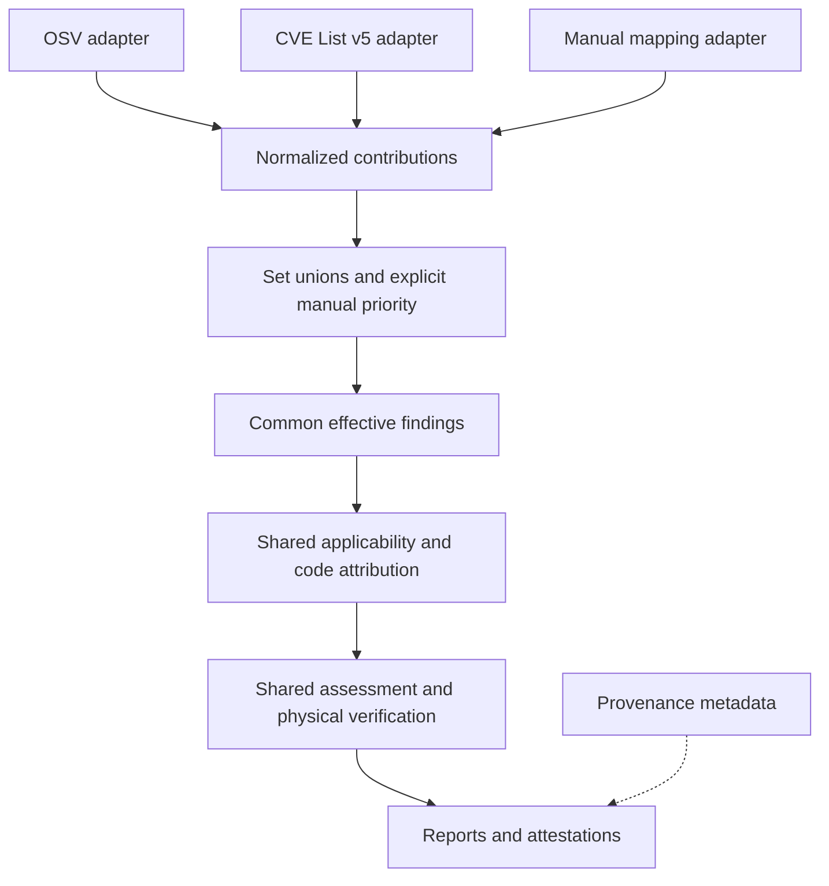

<!-- WHY: Makes the requested source-independent finding architecture reviewable before implementation, with explicit behavior changes, evidence boundaries, and acceptance tests. -->
# Plan: Source-Independent Vulnerability Findings

## Status and scope

Proposed plan, 2026-11-04. Implementation has not started. Inspected code revision: `9ccf50eaa857c5cbcfa993b7e910f33765eb827f`.

The user's requirement is:

> All datasourxes (currently the two we have, plus the manual vulnerability mappings) should be ingested into a generic set of CVE findings so that our handling of the findings is independent of the source of the finding. For the reporting we should retain the source of the finding but that is metadata for display not business logic.

The follow-up instruction is:

> We first need a plan

The subsequent merge requirements are incorporated: sources can supply complementary code information; normalize code paths and treat them as sets; ignore severity; widen affected-version coverage to include both inputs. The user explicitly selected set union that preserves gaps between disjoint version ranges.

The user also confirmed that manual mappings have higher priority but use the same handling. For a matching CVE, artifact and applicable version, explicitly supplied manual fields override automatic fields; omitted fields remain eligible for enrichment from other sources. This is merge policy, not a separate source-specific assessment or proof path.

Initial scope is the existing OSV Maven source, downloaded CVE List v5, and effective-project-POM vulnerability mappings. Additional providers, watched-repository release discovery, and centrally published mapping dependencies remain separate investigations. This plan introduces no new remote service, mandatory dependency, provider framework, or exact-JDK requirement.

Related research: [RQ-0020](../research/RQ-0020-advisory-source-coverage-and-scanner-finding-projections.md) and [RQ-0021](../research/RQ-0021-centrally-distributed-vulnerability-mapping-dependencies.md).

## Architectural contract

Equivalent normalized claims under the same explicit merge policy must produce the same applicability, code attribution, assessment, and proof eligibility regardless of their provider or ingestion order. Changing provenance alone may change displayed attribution, but must not change business outcomes. Manual contributions receive higher merge priority as explicitly requested; this priority selects effective facts and does not grant proof authority.

Findings merge by vulnerability identity and exact component identity. Missing code information is not a contradiction. Different automatic code sets and affected-version ranges are combined under the merge contract below, not rejected as source conflicts. Applicable manual overrides are applied before the common assessment receives the effective result.

Provider-specific parsing, retrieval, and refresh bookkeeping belong at ingestion boundaries. Manual priority is represented explicitly at the common merge boundary; assessment and proof do not branch on provider name or priority. Content identity and snapshot integrity remain validation inputs under the same rules for every source; the provider's name is not an integrity check.

This requires replacing existing behavior, not wrapping `OsvAdvisoryRecord` with another name. That record currently requires OSV ownership; explicit mapping evidence hardcodes POM origin; structured evidence requires CVE List origin; proof dispatch gives POM mappings a separate route and requires an OSV/CNA owner combination. Preserve the user's manual correction priority through the common merger while removing these source-specific assessment and authority gates.

The new architecture must explicitly supersede those source-authority portions of [ADR-0006](../adr/0006-dual-source-vulnerability-advisory-ingestion-from-cvelist-v5-and-osv-maven.md) and [ADR-0008](../adr/0008-precondition-gated-vex-attestations.md). The portable runtime and bytecode-first constraints of [ADR-0013](../adr/0013-compiler-decoupling-multi-jdk-portability-and-report-driven-liveness.md) remain. The architecture change is proposed here, not marked implemented or accepted by editing the existing ADRs prematurely.

## Common data model

Use a small immutable model with a clear separation between semantic facts and provenance. Exact Java names and serialized fields are to be settled with the first slice.

| Part | Required content and semantics |
| --- | --- |
| Vulnerability identity | CVE identifier when present, advisory identifiers and explicit alias relationships; preserve GHSA-only advisories without fabricating CVEs |
| Component and applicability | Exact Maven identity including type/classifier where known; a union of supported affected-version sets, with inclusivity, exclusions and disjoint gaps preserved; explicit unknown/unsupported outcomes |
| Code and prerequisite claims | Sets of normalized class names, source paths, routine identifiers and prerequisite declarations; distinguish explicit declarations from heuristic leads |
| Claim correlation | Retain affected-entry and version relationships as semantic context; different source scopes do not block finding merges, but a code declaration is not automatically extended to versions outside its declared coverage |
| Merge policy and field presence | Explicit priority, override scope and which semantic fields were supplied; manual contributions take precedence over automatic values for those fields while missing values can be enriched |
| Integrity and lifecycle | Identified validated input snapshot, content identity, current/withdrawn status, and completeness/error state under common validation rules |
| Provenance | All contributing source names, original record/container locations, URLs and publication/observation metadata for explanation and reporting |

One vulnerability/component finding aggregates version coverage and code sets while retaining its contributing assertions and provenance. Deduplicate equivalent normalized claims, retain complementary claims and scoped manual replacements, and preserve the version context needed to select applicable code for a concrete artifact. Provider-specific names or source prefixes must not be hidden inside evidence types and then used to grant proof authority. Severity scores and rankings are outside this finding model and its merge/assessment logic.

Assessment should receive semantic facts rather than provider-specific record types. Distinguish an explicit code declaration from a name extracted from prose by what the input actually asserts, using the same classification for every adapter. Confidence must not become a proxy for provider trust or independently mint proof capability. The first architectural slice must define common confidence/review-only semantics and document any change to existing manual LOW/MEDIUM behavior.

## Merge contract

1. **Group the same vulnerability and component.** Use established vulnerability aliases and exact Maven component identity. Do not merge unrelated vulnerabilities or different type/classifier identities based on similar names.
2. **Enrich missing details.** A package-level finding with no code paths receives applicable paths/classes/routines supplied by another input. Missing information is not an assertion that no vulnerable code exists. A manual field that was omitted is eligible for this same enrichment.
3. **Normalize before set union.** Normalize path separators and redundant syntactic components, then deduplicate established equivalent paths. Recognized source roots can map to the same package-relative path under the supported layout rules. Preserve Java case and package structure; equal basenames alone do not identify equal files. Preserve routine owners, nested-class identity and any supplied signatures. Further equivalence can be established by the shared artifact attribution step, rather than by aggressive string rewriting.
4. **Accumulate distinct code claims at the same priority.** Automatic `{Foo}` and `{Foo, Bar}` merge to `{Foo, Bar}` after normalization. Different sets, ordering, or path spellings are not themselves conflicts. Apply explicit manual replacements as described below. Unresolvable attribution remains a visible claim and does not erase the finding.
5. **Union affected-version coverage.** Normalize supported source version predicates, including exclusions, ordered changes and default status where supported, into faithful affected-version sets. Union those sets and coalesce overlapping intervals without filling unaffected gaps. `[1.0,1.2)` and `[1.4,1.6)` remain disjoint; `[1.0,1.3)` and `[1.2,1.5)` become `[1.0,1.5)`. If any supported input marks a version affected, an unaffected assertion from another input does not veto it. Unsupported predicates remain explicitly unresolved rather than becoming an invented all-versions range.
6. **Preserve version-specific attribution.** At a candidate version, combine code claims applicable there. A code claim from one input can enrich another input's package-only finding where its coverage applies; equal provider scopes are not a prerequisite. The aggregate version union does not by itself prove that a path declared only for version A is vulnerable in version B. B remains an affected finding when supported, with code attribution unresolved if no applicable mapping is available.

Merge results must be commutative, associative and idempotent for semantic findings with their explicit priorities. Combining duplicates or changing ingestion order must not change affected coverage, effective code sets or assessment. Preserve all contributing provenance, including superseded contributions, in deterministic reporting order.

### Manual priority

- Apply manual overrides only to the same vulnerability identity, exact Maven component and versions covered by the manual declaration. Keep unrelated findings and automatic coverage outside that scope. A manual version range defines its override scope; it does not assert that other versions are unaffected merely by omitting them.
- Replace explicitly supplied semantic fields with their manual values; enrich omitted fields from the automatic merge. Treat vulnerable-code mappings as one logical field across class, source-file and routine representations, so an automatic path cannot reintroduce code intentionally replaced by a manual class set. Keep prerequisite dependency/class declarations together so enrichment cannot create a different prerequisite pair.
- Preserve omitted versus explicitly empty fields before conversion loses that distinction. An explicit empty code set, where supported, clears that code mapping for the override scope; it does not mean the vulnerability is absent or authorize an omission attestation. Verify actual Maven parameter binding for omitted/empty values in an integration fixture before promising this configuration behavior.
- Normalize and combine same-priority set-valued contributions deterministically. Never let POM row order select an arbitrary winner. Any remaining ambiguity in non-set policy fields must be diagnosed and settled in the common contract before implementation.
- Validate manual declarations normally. Invalid declarations fail explicitly; unresolved winning declarations or review-only intent cannot be bypassed by falling back to a lower-priority automatic claim. Priority is not an evidence-strength label and cannot bypass version matching, attribution, confidence/review rules or physical checks.
- Report which fields were enriched or overridden and retain their original contributions as attribution. The downstream assessment consumes the same effective claim types whether their values came from a manual override, an automatic union or complementary enrichment.

## Ingestion and refresh

- **OSV:** normalize package identity, alias, version, lifecycle and usable claim data; retain package-only and no-CVE records.
- **CVE List v5:** discover records independently of OSV aliases, preserve affected-entry/container boundaries, and extract supported machine-readable Maven identities and affected/code claims. A CVE-only Maven finding must be possible. Missing or unsupported identity/range data remains unresolved; product-name similarity must not manufacture a GAV.
- **Manual mappings:** normalize the existing POM fields into the same claims and apply the same validation. Compose project-specific mappings with cached external findings for that invocation; do not publish one project's manual rows into the shared advisory cache.

The shared cache must stop treating every record as OSV-owned. Reconcile each source's records independently, then build the common view. An OSV update or withdrawal must not erase CVE-only assertions; changing one manual row must not mutate the shared external index. A withdrawn assertion does not erase independent active assertions from other inputs.

Keep first-build and refresh costs bounded: reuse the current local CVE checkout and persisted index, evaluate changed source records on refresh where a reliable change boundary is available, and avoid rescanning the whole CVE repository for every artifact or invocation. Use an explicit rebuild when the incremental boundary is unavailable. A failed download or Git sync must remain a failed/stale source observation, not an apparently successful empty source set.

## Shared assessment rules

1. Match component identity and evaluate supported version semantics without consulting provider identity. One independently applicable source can produce a finding; another provider's participation is not mandatory.
2. Merge same-vulnerability/component findings using normalized automatic code-set union, scoped manual field overrides, and affected-version union with gaps preserved. Missing paths, different automatic code sets, and different supported version ranges do not trigger a conflict state. Unknown or unsupported data remains visible without vetoing supported affected coverage.
3. Resolve the merged applicable classes, source-file claims and routines through common artifact-bound attribution. Fix qualified routine matching as part of this step, retaining declaring-class information and handling overloaded or ambiguous method claims conservatively.
4. Keep ordinary package matches and heuristic leads separate from verified code attribution. Unsupported or incomplete attribution cannot silently become a complete vulnerable-class set.
5. Use the same physical omission and prerequisite checks for every normalized claim. Preserve exact artifact identity, archive digests, relevant nested classes, complete opted-in prerequisite inventory, and explicit failure/unknown handling. Do not require an OSV owner, a POM origin, or an OSV/CNA pair to enter those checks.
6. Check all distinct applicable code declarations in the effective result after priority resolution. Removing one declared class must not hide another effective declaration whose class remains. An unresolved effective code declaration prevents an unqualified aggregate omission result; narrower verified class-absence observations may still be reported with their scope. Superseded automatic code remains audit metadata rather than silently joining the effective manual replacement. A package-only finding supplies no code-set completeness guarantee. A result about verified declared classes does not assert that a publisher's list is complete or that package-level scanner findings will disappear. Failed/stale configured input observations remain visible and cannot silently appear as complete coverage; no particular provider is mandatory.

Manual correction priority is intentional and explicitly required. It belongs in the generic merge policy, replacing the current separate POM assessment/authority route. Once resolved, manual and automatic values follow identical applicability, attribution, verification and reporting behavior.

## Implementation slices

Each slice starts with failing behavioral tests, then minimal implementation, formatting and relevant checks. Types or passing isolated adapter tests alone do not establish production completion.

| Slice | Change | Observable completion evidence |
| --- | --- | --- |
| 1. Contract and normalization | Draft the architecture decision, define shared finding/assertion types, field presence, path normalization, version-set union, scoped manual priority and common confidence rules | Tests prove complementary enrichment, manual supplied-field override, normalized set behavior, gap-preserving union and independence from provenance |
| 2. Independent adapters and index | Normalize OSV, independently indexed CVE entries and invocation-local manual mappings; change cache publication/reconciliation to store generic assertions | CVE-only, OSV-only, GHSA-only and manual-only cases survive actual cache load/refresh and produce expected findings |
| 3. Shared applicability and reconciliation | Replace separate OSV/POM assessment paths with alias/component grouping, normalized unions, manual priority and missing-field enrichment | Input permutations, duplicates, automatic differences, manual replacements and version ranges have deterministic outcomes; unsupported data stays explicit |
| 4. Shared attribution and verification | Replace source-gated proof dispatch and validators with claim-based validation; correct routine matching and preserve physical proof limits | The same supported code/prerequisite declaration passes or abstains identically through every adapter; retained or ambiguous classes prevent the corresponding omission result |
| 5. Maven/report/schema integration | Wire analyze, elide, report replay and attestations to common results; retain all provenance and useful diagnostics | Real Maven goal fixtures exercise each source alone and combined; reports do not double-count duplicates and replay requires no network |
| 6. Cleanup and integration validation | Remove obsolete source-owned assessment paths, update applicable docs/ADRs/RQs and generated examples, and verify combined behavior | Repository checks pass; the requirement matrix has production wiring and evidence for every required behavior |

The slices are sequential where contracts are shared. Model/cache work must settle before downstream integration; any parallel implementation should have bounded file ownership rather than competing changes to the assessment path.

## Acceptance matrix

All rows are planned, not implemented or verified.

| ID | Required behavior | Planned proof |
| --- | --- | --- |
| GF-01 | Every existing source independently contributes findings | Deterministic fixtures for CVE-only, OSV-only, manual-only and combined inputs through production entry points |
| GF-02 | Downstream behavior is independent of source metadata | Equivalent effective semantic payloads through each adapter where expressible, plus provenance swaps while keeping explicit merge policy unchanged; applicability, assessment and proof eligibility remain equal |
| GF-03 | Automatic unions and manual priority have explicit semantics | Automatic path subsets/distinct paths union; manual supplied fields replace automatic fields across code representations, omitted fields enrich, scope boundaries hold, row order is irrelevant, and priority cannot bypass review/verification |
| GF-04 | Coverage unions preserve scope and aliases | Overlapping/disjoint ranges, inclusive/exclusive boundaries, supported changes/default status, unsupported schemes and affected/unaffected disagreement; preserve gaps and version-specific code attribution; unrelated entries/classifiers/aliases cannot be spliced |
| GF-05 | Code claims normalize and resolve consistently | Separator/root variants and reordered sets deduplicate; identical basenames in different packages and Java case remain distinct; qualified routines, overloads, nested classes, ambiguous owners and missing metadata produce expected attribution or abstention |
| GF-06 | Physical proof constraints are preserved | Missing original class, retained affected/inner class, changed archive and incomplete prerequisite inventory prevent unsupported omission/precondition results |
| GF-07 | Independent source refresh preserves unrelated claims | OSV withdrawal/update leaves active CVE claims intact; manual rows stay project-local; failures do not become successful empty refreshes |
| GF-08 | Serialization and replay preserve the common model | Cache/report roundtrips and malformed-input rejection; offline assessment and replay preserve merged intervals, code sets, no-CVE identities, provenance and unresolved states |
| GF-09 | Actual Maven goals and outputs use the common pipeline | Analyze/elide/report and attestation integration reject old source-specific paths; preserve GHSA-only IDs where supported or explicitly report why no attestation can be emitted, without fabricating a CVE or dropping the finding |
| GF-10 | Runtime and operational constraints hold | Standard JDK 21+ checks, existing cache/refresh behavior tests and bounded refresh work; no new provider dependency or JDK pinning |

Share expensive immutable fixtures and use aggregate assertions. Integration fixtures should be local and deterministic; live OSV/Snyk availability is not an acceptance-test dependency.

Include explicit commutativity, associativity and idempotence scenarios and a case where a broader affected-version union has code attribution for only part of its coverage. That version must remain a finding even when code attribution is unavailable. Audit CVE-named result types and grouping/sort keys as well as adapter output so no-CVE findings survive the actual reporting boundary.

## Persisted formats, documentation and verification

Update cache and report writers, readers, validators, fixtures, report rendering and VEX payloads together. Audit which formats have actually shipped. Keep unreleased formats at schema version 1 and reject superseded unreleased shapes explicitly; do not add draft migrations or compatibility aliases. A changed released format needs its own version increment and a documented compatibility decision.

Update relevant user guidance, Maven usage/site content, goal descriptions, the contributor decision register and FAQ when behavior changes. Append implementation evidence to RQ-0020 and align RQ-0021's future catalog consumption with the common model; keep unresolved investigations open. Refresh generated transcripts when affected examples or documented output change.

During implementation, use focused core/plugin tests after each change, run the repository's formatting before investigating mechanical failures, and finish with `make check`. Run `make update-transcripts` when the generated examples are affected, then check the resulting changes. Verify applicable standard JDK configurations without introducing a vendor/build dependency.

## Decisions for plan review

- Accept the common normalized model and remove provider identity from assessment and proof policy, including existing source-gated evidence classes.
- Apply normalized automatic code-set enrichment and gap-preserving affected-version union; apply higher-priority manual supplied-field overrides within their declared scope, enrich omitted fields, and exclude severity logic.
- Retain no-CVE advisories and preserve unsupported/unmapped claims without inventing project applicability.
- Settle common confidence/review-only semantics and alias ambiguity behavior in the architectural contract before implementation; do not reclassify ordinary differences in code sets or supported version ranges as conflicts.
- Preserve physical verification and integrity rules while applying them equally to every source.

This plan is ready for review. No implementation, branch, worktree or commit is created by this planning step.
