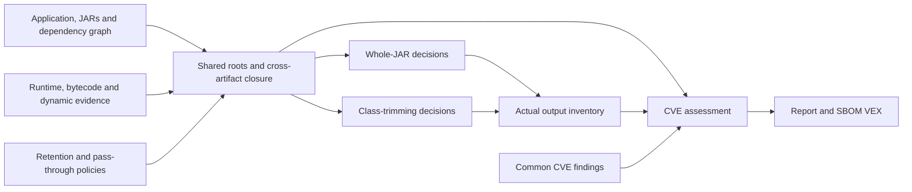

<!-- WHY: Gives the next implementation session an evidence-based plan for propagating prerequisite facts through inventory assessment and publication. -->
# Handover: Align Liveness, Vulnerability Evidence, and Reporting

## Status and objective

Implementation handover, 2026-11-06. **This file is the single entry point for the complete work package.** Start here to audit the project, implement the required changes, and verify code, tests, examples, documentation, and outputs together. This document incorporates the conclusions, constraints, and remaining investigations from [RQ-0020](../research/RQ-0020-advisory-source-coverage-and-scanner-finding-projections.md) and [RQ-0021](../research/RQ-0021-centrally-distributed-vulnerability-mapping-dependencies.md). Those research records remain the historical evidence and follow-up logs; they are not competing implementation plans. Preserve their dated measurements and update them as work produces new evidence.

This is a plan, not a claim that the work is implemented. The first implementation task is a comprehensive current-state audit; the table below is the starting evidence, not a substitute for verifying the actual code and tests at the time work begins. Respect existing uncommitted work in the main worktree and do not assume a clean baseline.

Make every relevant finding and its applicable evidence flow from ingestion through the common assessment to the report and SBOM. Evaluate a known necessary prerequisite against the actual final inventory even when it was already absent before Elider ran. Emit a scoped `not_affected` VEX result when that evidence supports it, while separately recording whether Elider caused the absence. The `trimJars` setting must never enable or disable assessment or publication. A change in actual retained contents may legitimately change the answer.

Use the existing common finding pipeline and user-approved merge contract. Move the default elision execution to `process-classes` as previously directed, and make the assessed inventory boundary explicit. Do not claim that a phase alone proves the later packaged or deployed runtime inventory.

Whole-JAR elision and class trimming must consume one shared liveness analysis and dataset, computed before either decision. This is a requested architecture change, not a claim that the current separate decision paths already do so.

## Current-state audit: where to start

Reconstruct each flow end to end, including the data actually passed between components, persisted formats, both Maven goals, and the example invocations. Record the current revision, dirty-worktree state, commands, data snapshots, outputs, and any failures. Validate existing tests by checking what their assertions demonstrate; a test name or an old research checkpoint alone does not establish today's behavior. For every discrepancy, identify the producer, transformation or dropped field, consumer, and observable consequence before designing the change. Do not overwrite unrelated work or change generated transcript blocks by hand.

| Surface | Current evidence to verify | Required alignment |
| --- | --- | --- |
| Advisory discovery and cache | [OSV adapter](../../elider-core/src/main/java/io/github/spockz/elider/scanner/OsvVulnerabilityFindingAdapter.java), [CVE adapter](../../elider-core/src/main/java/io/github/spockz/elider/scanner/CveVulnerabilityFindingAdapter.java), [generic cache](../../elider-core/src/main/java/io/github/spockz/elider/scanner/GenericFindingCacheManager.java), and [optional Snyk integration](../../dependency-elider-maven-plugin/src/main/java/io/github/spockz/elider/plugin/SnykPackageIssuesIntegration.java) exist. Both primary automatic adapters currently omit prerequisite groups; a CVE record without supported Maven identity does not independently become a Maven finding. | Preserve source facts and status through the common pipeline, including unsupported identity and incomplete source observations. Make independently usable evidence discoverable without inventing artifact mappings or turning source labels into business logic. |
| Reconciliation and mappings | [Common reconciler](../../elider-core/src/main/java/io/github/spockz/elider/model/GenericFindingReconciler.java), [attribution resolver](../../elider-core/src/main/java/io/github/spockz/elider/model/CodeAttributionResolver.java), and effective-POM mappings are integrated. [ADR-0014](../adr/0014-source-independent-vulnerability-findings.md) defines normalized set union, version-gap preservation and manual priority. A shared catalog is not implemented. | Verify the full path and preserve approved semantics for every source, including a shared catalog; separate a supplemental mapping's scope from an affected-version assertion. |
| Liveness and artifact choices | [Whole-JAR pruning](../../elider-core/src/main/java/io/github/spockz/elider/engine/DependencyPruner.java) and [class closure](../../elider-core/src/main/java/io/github/spockz/elider/trimmer/PreparedAnalysisState.java) have distinct entry points; [single-release orchestration](../../dependency-elider-maven-plugin/src/main/java/io/github/spockz/elider/plugin/SingleReleaseClosureAnalyzer.java) propagates cross-artifact roots. No option implements the requested runtime-evidence closed world. | One shared dataset supplies both decisions and distinguishes observed, static, dynamic and policy roots. Add the explicit opt-in policy without changing conservative defaults. |
| Assessment and output | [ElideMojo](../../dependency-elider-maven-plugin/src/main/java/io/github/spockz/elider/plugin/ElideMojo.java) currently couples prerequisite proof to `trimJars`; [publisher](../../dependency-elider-maven-plugin/src/main/java/io/github/spockz/elider/plugin/MavenElisionOutputPublisher.java) also gates SBOM/VEX publication. [AnalyzeMojo](../../dependency-elider-maven-plugin/src/main/java/io/github/spockz/elider/plugin/AnalyzeMojo.java) does not supply the corresponding inventory. Incomplete inspection reasons can be lost. | Assess the actual or predicted inventory independently of trimming, carry concrete reasons to the saved report, and emit supported final SBOM/VEX results. Show baseline versus final attribution. |
| Lifecycle and packaging | Default elision remains `initialize`; `process-classes` is supported through existing configuration but the Spring experiment hit a later-writer guard. The actual Spring Boot archive adds loader classes. | Make the planned `process-classes` default consistent across Maven integration, account for known packaging contents, and avoid rejecting ordinary repackaging merely because it is configured. |
| Tests and examples | [Generic findings lifecycle tests](../../dependency-elider-maven-plugin/src/test/java/io/github/spockz/elider/plugin/GenericFindingsLifecycleIT.java), [prerequisite publication tests](../../dependency-elider-maven-plugin/src/test/java/io/github/spockz/elider/plugin/ADR0008MavenPreconditionPublicationTest.java), [Spring example](../../examples/example-spring-boot-app/pom.xml), and [safe-class example](../../examples/example-cve-safe-class-app/pom.xml) cover different pieces. The safe-class case uses a local mapping and a trim-enabled execution; it does not prove the missing Spring/no-trim path. | Add end-to-end cases connecting the shared catalog, both goals, actual archives, source health, saved reports, and SBOM/VEX. Use complete pinned real databases for example and transcript coverage. |
| User and persisted output | README, [plugin usage](../../dependency-elider-maven-plugin/src/site/markdown/usage.md), Maven help, JSON report, SBOM, VEX and their validators can describe different behavior. Report replay uses saved data. | Align all surfaces, retain evidence in machine-readable output, keep normal logs concise, and regenerate configured transcripts. Offline replay must not re-query sources. |

The current audit should also inspect cache readers/writers/validators, output staging and cleanup, the Maven extension and dependency-tree preparation, direct and reactor executions, source observation diagnostics, `ExampleSupport`, example scripts, CI and Git LFS setup. For each surface, record **implemented**, **partially implemented**, **missing**, or **unverified**, with file/test/command evidence and the corresponding required work below. Investigate whether any earlier claimed defect has already been fixed before adding a new fix or test.

### Reproducible baseline and known measurement

Use the full pinned [OSV Maven and CVE List snapshots](../../scripts/fixtures/vulnerability-snapshots/README.md), not the historical small transcript cache. The saved 2026-11-06 Spring snapshot contains 101 finding rows, 100 distinct CVEs plus one GHSA-only advisory, including test-scope findings; 36 rows concern Tomcat Embed Core and 19 concern Jackson Core and Databind together. CVE List was `PARTIAL` after 79 malformed rows were skipped. These are pinned input observations, not current upstream counts or verified mitigations.

The same captured run pruned 3,429 classes and dropped no whole JARs; it produced no prerequisite or declared-code absence proof. The Logback/Janino evidence and actual package inspection are documented below. Re-run the actual examples against the pinned snapshots and record any changed result, scope, identity, source health and reason without rewriting the historical measurement. Tests for malformed records or impossible cases may use focused supplemental fixtures; do not substitute them for the real-database examples, README or usage transcripts.

## Coverage of both research records

The following table makes this handover sufficient to start the work without reconstructing requirements from prior chats. RQ sections remain available for detailed historical sources and observations.

| Topic | Work and decision boundary |
| --- | --- |
| OSV, CVE List and optional Snyk | Audit independent discovery, identity, version coverage, aliasing, enrichment and source-health reporting through the same model. Keep the existing optional Snyk package API integration and its credential/access limits; the available integration is not a complete public Snyk bulk dataset. Do not assume OSV includes the Snyk database. Evaluate data rights and actual availability before adding any further feed. |
| CVE source details | Retain supported structured file/routine declarations and version/entry correlation, including qualified routines and ambiguous attribution. Preserve provenance and review-only leads. A Git range, free text, fix commit, module name or product string is not automatically an exact Maven class or package claim. Surface indexing failures and `PARTIAL` state; isolate malformed individual records/entries while failing or marking stale failed downloads, archives and broken indexing as appropriate. |
| Source coverage and timing | Explain that CVE publication, CNA/NVD enrichment, reviewed package mapping, OSV ingestion and local refresh are different clocks. Pinned exports are reproducible, not live or complete coverage guarantees. Capture source revision, observation status and counts without claiming cross-scanner counts are interchangeable. |
| NVD/CPE candidates | The user requested investigation, not the addition of NVD as a source yet. Evaluate product-to-Maven matching, applicability and false positives using the recorded Tomcat/Jackson cases. Coarse CPE associations, if later approved, are candidates or scanner projections, not authoritative Maven findings or VEX. Do not implement NVD ingestion merely because this table names it. |
| Scanner projections | Preserve the difference between a baseline finding associated with a removed component, a potential CPE-based projection, and a delta observed by running the same scanner on comparable before/after inventories. Count finding instances, CVE/component pairs, distinct CVEs and aliases separately; same-GAV trimming may leave a package scanner finding. State unknown when identity, database revision, scan or matching data are missing. Direct verified code/prerequisite evidence can support a stronger assessment without rewriting an observed scanner result. |
| Git-only advisories | Investigate an opt-in association between affected Git ranges and upstream version tags, with annotation peeling, commit ancestry, branches/backports, incomplete history, snapshot freshness and explicit unknown results. Reuse repository observations for watched repositories rather than recomputing for each consumer. A tag, GitHub Release object or shared observation alone does not establish Maven-artifact provenance or a definitive affected finding. This remains research until a scoped implementation is selected. |
| Centrally distributed mappings | Deliver the explicitly selected data-only Maven catalog specified below. Preserve pinning, adoption, provenance, deterministic precedence, independence from the application classpath/SBOM, offline replay and source-independent verification. Compare plugin dependency and explicit coordinate resolution against real Maven behavior before fixing the user-facing syntax. |
| Version-scope correction | Fix the existing safe-class example's overly broad affected assertion and distinguish an explicit affected range from the coverage of supplemental code/prerequisite evidence. The approved affected-range union preserves gaps; the pre-ADR-0014 RQ-0021 text prohibiting such union is historical and superseded. |
| Attribution and VEX | An already-absent necessary dependency can establish bounded non-applicability and SBOM VEX, without claiming Elider removed it. Count actual removals separately. Do not make VEX assertions from weak product matches, absence of a finding, or an unverified future artifact. |

An investigation result may recommend no implementation. Record the evidence, decision and remaining uncertainty in the relevant RQ rather than treating every research question as an approved new data source, service, scanner or feature. Preserve the user's explicit direction not to add NVD yet.

## Evidence and root causes

The pinned real-data Spring example reports CVE-2025-11226 for Logback, but not its Janino prerequisite. The saved pre- and post-elision SBOM inventories contain no Janino, and inspection of the packaged application and its directly nested JARs found no `ClassBodyEvaluator` provider. This is bounded evidence about that artifact, not a statement about an eventual deployment. The report still says `NO_PROOF`.

The failure is a chain, not a single missing conditional:

1. The public advisory describes prerequisite conditions in prose, but the automatic adapters do not contribute a structured prerequisite. The current safe-class example supplies a local manual mapping; the Spring application does not inherit it. The advisory text alone does not establish a verified exact Maven coordinate and class for every affected version. There is no implemented shared mapping catalog.
2. `ElideMojo` passes `trimJars && preconditionClassPathComplete` to prerequisite assessment. `MavenElisionOutputPublisher` also gates SBOM/VEX publication, output ownership, and cleanup on trimming. A no-trim run therefore cannot produce the requested result through the current path.
3. Analysis supplies no prerequisite inventory. Incomplete-inventory diagnostics are dropped before assessment and can become a generic `NO_PROOF` explanation. The resulting messages obscure whether the missing input is a mapping, an uninspected provider, or a lifecycle boundary.
4. The existing safe-class test demonstrates a local mapping with `trimJars=true`; it does not demonstrate that a no-trim run produces an SBOM or that the Spring application receives the mapping. Its broad manual version range also currently asserts that fixed versions are affected.
5. A real Spring `process-classes` run still hits the existing later-writer guard for the configured Spring Boot `repackage` execution, even when the requested lifecycle stops before that execution. This can hide the inventory result. Changing the default phase alone will not fix the information flow or prove the contents of a later package.
6. Whole-artifact candidate decisions and class trimming currently have distinct entry points and representations. `DependencyPruner` derives an artifact decision from observed and compiler-required classes, while the trimming path builds class closures including cross-artifact references. Even where later orchestration adds safeguards, neither decision should depend on a separately constructed notion of liveness.

The detailed reproductions, version-range observation, and inventory fingerprints are in RQ-0020. Existing output and sources are observations, not an assertion that the proposed behavior is already present.

## Required behavior

### One liveness analysis for every elision decision

Build one baseline analysis over the application and the complete relevant resolved dependency graph before deciding which JARs to remove. The logical dataset must identify classes and their owners, evidence and configured roots, references across artifact boundaries, the resulting transitive closure, and unresolved or unsupported inputs. Runtime class-load observations, supported GraalVM metadata, production bytecode, framework and service metadata, and explicit roots contribute to the same closure. Supported multi-release views must retain their appropriate per-release identities. Shared analysis can use existing partitioned or incremental machinery; one dataset does not require a single giant in-memory graph.

In that dataset, a class reached from a root is live, including classes in other JARs needed by the closure. Classes outside the closure are dead candidates relative to the supplied evidence and supported analysis; do not label uninspected or unresolved classes dead. Retain complete class entries and their members under the current class-granularity contract. Explain that runtime traces and dynamic metadata have an evidence coverage boundary: missing observations are actionable only with the supported roots and analysis for the build.

The user additionally requested an explicit closed-world option: when selected, treat the supplied runtime evidence as exhaustive for the supported workload, so an unobserved class referenced only from an unexecuted method need not be retained solely because that reference exists. This is a different policy from the default class-reference closure described above. Preserve explicit, GraalVM and supported dynamic roots, and retain classes structurally required by surviving classes. Distinguish a class observed at runtime from one retained because of static linkage or policy. Do not interpret an absent method observation as evidence that its enclosing method never ran: a branch containing the reference may simply not have executed. Report the selected assumption and keep the default conservative. Apply the option consistently to `analyze` and `elide`, whole-JAR and class decisions, fingerprints and caches, and actual-output-based CVE results. Missing, malformed or otherwise known-unusable trace data must not silently count as exhaustive; do not require the tool to prove the user's workload-completeness assertion independently.

No current option implements this policy. `productionClassesComplete` and `sourceRootsComplete` describe available application inputs; `preconditionClassPathComplete` concerns prerequisite inventory. None switches off reference closure for an unobserved class. A retained class can still contain a symbolic reference to an omitted class under the requested assumption, so the implementation needs an explicit contract for class verification, mandatory hierarchy and dynamic roots rather than reusing the existing rule that every program reference must resolve. Test the output on supported standard JDKs and make the workload assumption visible to consumers.

Feed this same result into both decisions:

- **Whole JAR:** keep an artifact containing a live class, or one required by artifact-level policies and the retained dependency graph. An otherwise eligible artifact with no live classes can be removed only after these protections and graph constraints are evaluated.
- **Class trimming:** in an eligible retained JAR, retain its live classes and remove its dead candidates. Disabling `trimJars` changes the requested transformation, not the graph or evidence source. If preserving extra classes in an unchanged JAR creates actual linkage or resource requirements, account for those requirements in the same closure; do not assume the final artifact decision must be identical when the retained contents differ.

Apply explicit retention, pass-through, duplicate-owner, scope, resource and multi-release policies consistently. A JAR required to stay byte-identical contributes the references and dynamic roots of its actually retained contents to the common closure, including references into other JARs. Artifact graph ancestry, resource-only artifacts and explicit retention remain separate reasons an artifact may survive without a live program class. Resolve duplicate providers and unsupported references using the existing safety and policy contracts; never drop an owner merely because another owner is live. Reach a stable cross-artifact closure before removing any JAR or class. A policy-protected JAR may contain physically present classes outside the ordinary live set; record that distinction rather than calling them removed.

`analyze` and `elide` consume the same liveness semantics and inputs for equivalent scenarios, with predicted versus applied outputs clearly distinguished. The CVE assessment consumes both the shared liveness evidence and the actual baseline/final inventory: a dead candidate is not a removed class while it remains in an untrimmed or pass-through JAR. Do not reconstruct a second graph to assess findings, or treat a liveness classification as physical absence.

### Findings and evidence

- OSV, CVE List, optional configured sources, reusable mappings, and local manual mappings contribute to one source-independent model. Preserve provenance for explanation; do not branch assessment or VEX authority on a provider name.
- Merge aliases only when supported by source identity. Preserve exact component identity, affected-entry and version scope, source facts, review status, and unbound claims whose component cannot yet be established. Do not invent a Maven coordinate from a product name or a verified prerequisite from prose.
- Complementary facts enrich the same finding. Normalize code paths and compare sets; union independently asserted affected-version ranges while preserving disjoint gaps. Explicit manual fields override within their matching vulnerability, artifact, and version scope; omitted fields remain enrichable. Preserve the difference between omitted and explicitly empty fields.
- Separate a mapping's **evidence scope** from an independent assertion that every version in that scope is affected. Supplemental prerequisite data must not create an affected finding or fill a fixed-version gap by itself. Existing explicitly asserted affected ranges still participate in the approved union. Correct the safe-class example's overly broad claim as part of the general model change.
- Preserve useful original text and provenance as reviewable evidence when a source has no structured prerequisite. Keep candidate or unresolved text distinct from reviewed, version-scoped facts. A parsing failure for one source record may skip that record with a visible partial-source diagnostic; source download, archive, and systemic indexing failures must not appear as successful empty results.

### Obtain reusable prerequisite facts

Implement an explicitly selected, versioned, data-only Maven mapping catalog as the first reusable distribution path. It must be resolved independently of the application's dependency inventory and loaded into the same contribution and merge pipeline as other inputs. The selected catalog, content identity, row provenance, and failures must be visible in the report; a project-local manual supplied field retains its existing higher priority. Catalog origin alone conveys no special proof authority. Do not add catalog classes or transitive dependencies to the assessed application.

Choose and document one concrete Maven-native adoption mechanism after testing standard plugin dependencies against explicit artifact-coordinate resolution. A team must be able to publish a data-only artifact once and two projects with different parents adopt the same pinned version. Do not scan arbitrary application JARs for catalog files, execute catalog-provided code, or assume a project BOM manages plugin dependencies. Record selected Maven identity, artifact digest, schema version, record identity, advisory URL and source provenance; do not relabel catalog evidence as a local POM assertion. Pin and replay the same catalog bytes; a saved `report` must not resolve a newer catalog or use the network.

The catalog contract must cover the current local mapping's vulnerability and alias identifiers, exact component identity including type/classifier, affected-version assertions and separately scoped supplemental evidence, class/file/routine claims, prerequisite conditions, confidence/review intent, and field presence. Preserve vulnerable-code and prerequisite fields when both occur in a record. Explicit local supplied fields override within scope, omitted fields enrich, and automatic equal-priority sets and version claims use ADR-0014 union regardless of catalog order. Do not let an overridden review-only assertion be bypassed by a lower-priority claim. Apply semantic validation and physical verification to all sources equally; a catalog row or `HIGH` confidence alone cannot establish VEX.

Define stable row identities, duplicate-ID behavior, and diagnostics. Isolate malformed independent rows with visible `PARTIAL` status where the remaining catalog is safely interpretable; missing required artifacts, malformed containers, unsupported schema, ambiguous identity and systemic failures must remain explicit failures or unresolved states, never a successful empty catalog. Test online and cached offline use, missing/corrupt artifacts, dependency mediation, reactor timing, and that catalog inputs never appear as application dependencies, packaged runtime libraries, prerequisite providers or runtime SBOM components. Catalog identity remains visible in build-input provenance. Artifact version and schema version are independent, and version ranges or changing snapshots must have an explicit reproducibility policy.

Supply a reviewed, source-supported Logback/Janino mapping in a reusable pinned test catalog, with exact supported component, version and prerequisite scope. Verify the mapping against the relevant advisory and release/code evidence; do not hard-code a CVE in the plugin or require a separate vulnerability row in every consuming POM. The Spring integration fixture selects the shared catalog and proves the data propagates. Catalog adoption and broader distribution policy remain in RQ-0021; this minimal path makes the missing evidence available without assuming an existing external service or automatic prose interpretation.

### Inventory, applicability, and attribution

Create one assessment input representing the actual baseline and final inventories with their inspection coverage and failures. Populate it whether `trimJars` is enabled or disabled, and whether or not any JAR was transformed. It must reflect whole-artifact removal, the actual classes left in retained or transformed artifacts, application classes, and all supported providers within the declared boundary. Account for duplicate, shaded, and supported multi-release classes; do not infer class absence solely from the absence of a Maven coordinate. Record unreadable or unmodeled inputs as incomplete rather than silently treating them as empty.

For each matching affected component and supported necessary-condition claim, evaluate the condition against that inventory. Encode whether prerequisites are conjunctive or alternative instead of assuming that an arbitrary list has one meaning. If an exploit requires both A and B, absence of either established necessary condition can rule out that path. If alternative paths are described, rule out every applicable path before concluding non-applicability. Unknown claim semantics, review-only evidence, unknown providers, or incomplete inspection remain unresolved with a specific reason.

| Observed condition within the stated boundary | Result | Attribution |
| --- | --- | --- |
| Necessary prerequisite absent both before and after | Not applicable; publish supported VEX | Already absent; no elision credit |
| Necessary prerequisite present before, absent afterward | Not applicable; publish supported VEX | Removed by elision only when the actual provider disappearance is established |
| Prerequisite still present, including from another provider | No absence-based conclusion | No removal credit |
| Prerequisite or inventory unknown or incomplete | Unresolved, with the specific missing evidence | Unknown |
| Affected artifact itself removed | Record its removal and any scanner-result projection separately | Attribute removal only if established |

A matching version can still be in an advisory's affected range while the finding is not applicable to the inspected output because a necessary prerequisite is absent. Show these as distinct facts. Do not enumerate every vulnerability in the world for absent components. Do not turn a coarse package/CPE match into VEX, or describe a scanner finding as observed removed without running and comparing that scanner. Preserve the existing physical-proof requirements for code-removal conclusions.

The same actual baseline and final inventories must produce the same assessment with `trimJars` on or off. If trimming actually removes a necessary class, assessment uses the changed contents; the flag itself is never evidence. In particular, cover no trimming, enabled trimming with zero transformed JARs, removal of a whole dependency without trimming, and actual class removal.

### Reporting, SBOM, and analysis

Use one effective finding and assessment model for `analyze` and `elide`. Reports should carry the same evidence, status, source attribution, and reasons; phrase a hypothetical transformed result as predicted. A prerequisite observed absent in the baseline can be described as already absent in both goals. Do not publish a prediction as physical verification of an artifact that has not been produced.

For an applied, verified retained affected component, embed the supported result in the final CycloneDX SBOM with `analysis.state: not_affected` and `analysis.justification: requires_dependency`, tied to that component. Keep the standalone OpenVEX result consistent, including its impact explanation. This applies even when the prerequisite was already absent and even when `trimJars=false`. Preserve provenance and detailed evidence in the JSON report, with concise explanatory logs. Retain explicit reasons for absent mapping, incomplete inspection, deferred packaging, and other unknown cases.

Remove the trimming condition throughout publication, including staging, artifact ownership, manifests, and stale-VEX cleanup; do not manufacture a trim record. Define and document when a final SBOM and VEX are generated for no-trim runs. Verify reruns cannot leave an old VEX result behind after inputs change. Keep the original JAR untouched when no transformation is requested.

## Lifecycle and scope

Change the default to `process-classes` across the Mojo descriptor, extension phase inference and rebinding, goal ordering, dependency-tree preparation, explicit phase overrides, and documentation. Test real Maven lifecycle executions, not only direct Mojo calls. Update the affected lifecycle ADRs, including the existing `initialize` compatibility decision, before marking the change complete. Explain that `compile` stops earlier, that analysis is bytecode-first, and that inlined constants can require explicit retention.

Capture and assess the inventory actually available at the execution point. Ordinary repackaging of the analyzed classes and JARs must not require a second full scan or automatically defer the assessment. Account for known additional packaging contents: the inspected Spring Boot package, for example, includes loader classes, but these did not supply Janino. Distinguish a later writer that was configured but did not execute from one that actually adds or changes relevant providers. State the supported boundary in the output. When an executed packaging step adds relevant providers that the existing inventory does not cover, incorporate them or explicitly report the unsupported scope rather than guessing. A lifecycle stopping at `process-classes` must still produce the result supported by the inventory it actually inspected.

Handle a legitimate source-free module as distinct from a failed or missing compilation output. Include generated production sources, test-compilation ordering, reactor and dependency-tree behavior, and supported explicit phase configurations in the lifecycle tests. Do not tie any of this to a particular JDK vendor or patch release.

## Implementation slices and TDD

Begin with the current-state audit and inventory above. Reconcile every requirement in this handover with its existing implementation, test and output evidence; record missing work before changing behavior. The slices below describe the integration order, not independent definitions of done: update their design when audit evidence exposes a missing seam, and do not mark the work package complete because one slice passes in isolation.

For each slice, write observable tests first, run them and record the intended failure, implement the smallest general fix, then run the relevant tests. Share expensive fixtures and executions where their inputs and lifecycle allow it. Verify actual Maven parameter binding and real generated artifacts rather than only internal methods or synthetic mocks. Keep real upstream source snapshots as the example and end-to-end database; focused synthetic cases may supplement them for edge conditions. Test both goals, saved-report replay and final files across slice boundaries.

1. **Shared liveness and closed-world option.** First write and run failing end-to-end fixtures covering a live class in JAR A referencing an otherwise unobserved class in JAR B; an unrelated dead class in each; a wholly dead JAR; and a retained whole JAR referencing a class in another JAR. In the conservative default, retain required static closure. With the new option, exercise a reference in an unexecuted method or branch: B can be removed when absent from the complete trace while an observed B, required superclass/interface, explicit root and supported dynamic root remain. Run the observed workload against the resulting artifact and check the documented behavior when the previously unobserved path executes. Assert both the JAR and class outcomes from the same shared dataset, then assert `analyze` prediction matches `elide`. Repeat relevant scenarios with trimming disabled and enabled, including references from extra classes preserved when no trimming occurs, and cover duplicate owners, resource-only artifacts, explicit retention, relevant multi-release tiers, graph constraints, unresolved inputs, cache separation, and incomplete trace failures. Establish a single shared liveness dataset and adapt both existing decision paths to consume it.
2. **Evidence and reusable mapping.** Test two projects consuming the same catalog without duplicated POM vulnerability rows; one source supplies the finding and another its prerequisite. Test provenance, equivalent input order, manual override and omitted/empty fields, source-record isolation, and unsupported identity. Test affected-range boundaries including fixed versions and disjoint gaps. Implement the supplemental evidence scope and catalog ingestion, reader, writer, validation, and documentation together.
3. **Inventory and assessment.** Test baseline-absent, elision-removed, present elsewhere, retained artifact with an absent necessary class, alternative/conjunctive paths, and incomplete or unreadable inventory. Check exact provider attribution. Run matching trim-on and trim-off cases with identical actual inventories, plus cases where contents really change. Preserve the specific incompleteness reason from capture through the report.
4. **Publication and analysis parity.** Add real Maven executions asserting the persisted report, final CycloneDX embedded VEX and OpenVEX, component identity, absence attribution, and no-trim publication. Exercise a rerun that invalidates a prior result to verify stale output cleanup. Check `analyze` produces equivalent predicted results without claiming a hypothetical physical artifact was verified.
5. **Lifecycle.** Add failing Maven integration tests for the selected default phase, actual execution ordering, a source-free module, explicit bindings and the Spring packaging case. Implement the default and inventory/publication boundaries together, then check `clean process-classes`, `clean package`, test compilation, dependency-tree invocation, and a supported reactor.
6. **Real-data acceptance and documentation.** Use the pinned complete OSV and CVE List snapshots already used by examples, plus the reviewed shared mapping catalog. Run the Spring example and verify that Logback's Janino prerequisite is reported as already absent and `not_affected` within the verified output boundary, with matching SBOM VEX and no claim that elision removed Janino. Keep real snapshots in the README, usage examples, and example tests; use small supplemental fixtures only for targeted edge cases. Regenerate affected transcripts using `make update-transcripts`, then run `make check-transcripts`.

Amend [ADR-0008](../adr/0008-precondition-gated-vex-attestations.md) for the bounded inventory and prerequisite semantics, and the applicable lifecycle ADRs for the default-phase change. Preserve the [ADR-0014](../adr/0014-source-independent-vulnerability-findings.md) merge policy. Replace the existing opt-in and trim-based gates with evidence and scope checks; do not retain an opt-in as a hidden prerequisite to ordinary assessment. For unreleased persisted formats, update writer, reader, validation, fixtures, and documentation together while keeping the current schema version 1.

### Cross-surface acceptance matrix

At audit time fill in current evidence for every row; as work progresses attach exact tests, commands and artifacts in a closeout or status section. A missing, untested, or disconnected row remains open even if a nearby unit test passes.

| Requirement | Observable completion evidence |
| --- | --- |
| Shared liveness and closed-world flag | Both Maven goals use the same class/owner/graph evidence for equivalent inputs. Real compiled and packaged fixtures show the default and opt-in results for a static reference in an unobserved branch, a live cross-JAR dependency, a mandatory superclass/interface, explicit and dynamic roots, and policy-protected content. Cache reuse cannot mix policies. Document the workload assumption and resulting behavior when an unobserved path is later executed. |
| Independent advisory ingestion and merge | Real pinned OSV and CVE List data run through production indexing and goal assessment. Focused records demonstrate independent discovery, exact artifact/version scope, aliases, qualified names, normalized sets, disjoint ranges, manual precedence, omitted/empty fields, attribution, provenance, and partial/failure isolation. Reordering sources cannot change semantic results. |
| Shared Maven mappings | Two separate projects adopt one pinned data-only catalog; mappings enrich either source without copied project POM rows. Verify version gaps, both prerequisite and code fields, local overrides, offline replay, no application classpath/package/SBOM contamination, and explicit partial or failure diagnostics for invalid inputs. |
| Inventory, attribution and CVEs | Exercise prerequisite already absent, actually removed, still present, provided elsewhere, and unknown; include class absence with a retained owner and Boolean alternatives. Test real archive entries, exact original/final providers and no-trim runs. An unaffected version is not marked affected by a supplemental mapping's scope. |
| Reports, SBOM and replay | Compare `analyze`, applied `elide`, and saved `report` for matching evidence with predicted versus applied wording. Check concise normal logs, correct section grouping and actionable source-health warnings; keep detailed provenance in JSON. Verify CycloneDX VEX and OpenVEX consistency, correct affected-component identity, prior-absence attribution, cleanup of stale outputs and network-free replay. |
| Maven lifecycle and packaging | Actual Maven `process-classes` and `package` executions, source-free and generated-source modules, standalone dependency tree, explicit bindings, test compilation and a supported reactor show the chosen timing and inventory boundary. Spring repackaging does not suppress a valid assessment solely because its goal is configured. |
| Examples and generated docs | Run the Spring, safe-class and relevant multi-module examples against pinned complete real snapshots; confirm source status and findings are visible, Janino is already absent and not credited to elision, and final SBOM carries the supported result. Regenerate README/usage transcript blocks using the repository command and check for drift. Review plugin help and user FAQ for flag, catalog, lifecycle, results and limits. |
| Research and implementation scope | Reconcile every row in **Coverage of both research records** with an implementation, explicit investigation outcome or deferred proposal. Record scanner dataset/input/scope and comparability for any new count. Do not add NVD ingestion or turn Git-range hypotheses into package claims without a separately selected scope. Append evidence to RQ-0020/0021. |

Run the narrow tests for each red/green slice, then the repository's relevant `make test-core`, `make test-plugin`, `make test-examples`, `make update-transcripts`, `make check-transcripts`, and `make check` as applicable. Use the repository's formatting before diagnosing mechanical failures, and include Markdown lint. Inspect generated diffs and preserve the user's existing changes. Report any unavailable LFS data, external source, catalog, or test as a failure or limitation rather than a zero result.

## Completion and verification

The work is complete when all six slices pass, whole-JAR and class decisions use the same liveness dataset, the Spring example demonstrates the requested result from shared evidence, no-trim output has equivalent assessment and VEX for equivalent inventory, and incomplete or unsupported cases remain visible rather than producing false certainty. Run the relevant plugin and example tests, formatting and Markdown checks, transcript regeneration and drift check, and the repository's `make check`. Record actual commands, test results, remaining scope limits, and any performance impact in a separate closeout. Do not replace real-data example coverage with synthetic-only tests or overwrite existing research snapshots.

The mapping catalog cannot make public advisory prose structured by itself. Its reviewed coverage and the observed inventory boundary must remain explicit, and an unknown result is appropriate when the necessary evidence is genuinely unavailable.
