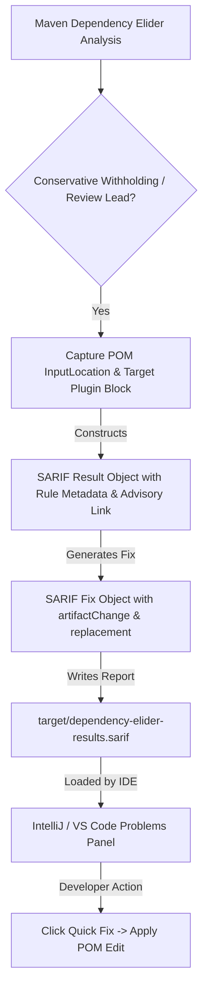

<!-- WHY: Investigates turning conservatively withheld CVE suppression evidence and advisory gaps into actionable developer workflows (standard IDE diagnostics, code actions, SARIF, AI/LLM prompting) without authoring bespoke IDE plugins. -->
# RQ-0019: Developer-Actionable Advisory Workflows, IDE Quick Fixes, and Guided Remediation Without Bespoke Plugins

## Status

Open

## Context and Current Boundary

In `maven-dependency-elider`, vulnerability assessment and VEX attestation adhere strictly to "Fail-Closed" and "Zero Hallucinated VEX" principles established in [ADR-0003](../adr/0003-proguard-core-intra-jar-trimming-and-cyclonedx-pedigree.md), [ADR-0006](../adr/0006-dual-source-vulnerability-advisory-ingestion-from-cvelist-v5-and-osv-maven.md), [ADR-0007](../adr/0007-proven-serviceloader-spi-roots-and-conservative-cve-exclusions.md), [ADR-0008](../adr/0008-precondition-gated-vex-attestations.md), and [RQ-0015](RQ-0015-actionable-advisory-gap-detection-and-heuristic-elision-candidates.md):

1. **Conservative Withholding**:
   * The plugin identifies when a library has been heavily trimmed (e.g., 95%+ of its classes pruned) or when an advisory's preconditions are unsatisfied.
   * If mathematical link-closure proof or physical bytecode verification cannot conclusively prove that the vulnerable entry points are absent (e.g., unmapped upstream CVEs described only in unstructured prose, ambiguous affected version ranges, or unverified source attributions), the plugin **conservatively withholds VEX suppression** (`not_affected`).
   * Instead, it generates review-only leads, logs warnings/notices, or outputs raw advisory review rows in `dependency-elider:report`.

2. **The Remediation Friction**:
   * Currently, the plugin formats copy-pasteable XML snippets directly in the terminal logs via [`MavenVulnerabilityOverrideSnippet.java`](../../dependency-elider-maven-plugin/src/main/java/io/github/spockz/elider/plugin/MavenVulnerabilityOverrideSnippet.java):

     ```xml
     <configuration>
       <vulnerabilityMappings>
         <vulnerabilityMapping>
           <cveId>CVE-2022-42889</cveId>
           <groupId>org.apache.commons</groupId>
           <artifactId>commons-text</artifactId>
           <versionRangeSpec>[1.0,1.10.0)</versionRangeSpec>
           <vulnerableClasses>
             <vulnerableClass>org.apache.commons.text.lookup.StringLookup</vulnerableClass>
           </vulnerableClasses>
           <confidenceLevel>HIGH</confidenceLevel>
         </vulnerabilityMapping>
       </vulnerabilityMappings>
     </configuration>
     ```

   * While having copy-pasteable snippets in CLI output is an improvement over raw IDs, the developer workflow remains manual and fragmented:
     * The engineer must locate the snippet in scrollback or reports.
     * Switch to the IDE and locate the correct `<plugin>` block for `dependency-elider-maven-plugin` inside `pom.xml`.
     * Carefully paste and format the snippet inside `<configuration>`, avoiding accidental duplication of `<vulnerabilityMappings>`.
   * True **"auto actions"** or in-editor **"quick-fixes"** (where the developer clicks an inspection lightbulb or action button in VS Code / IntelliJ and the POM is automatically updated with the exact snippet) would eliminate this friction entirely.

3. **Constraints**:
   * **No Bespoke IDE Extensions**: Developing, maintaining, distributing, and signing separate IntelliJ IDEA and VS Code plugins introduces immense maintenance overhead, ecosystem drift, and multi-IDE fragmentation.
   * **Documentation and Tooling Invariants**: Solutions must leverage standard protocols, formats, or CLI interfaces rather than custom binary extensions.

---

## Research Questions

1. **Standard Diagnostic Protocols**:
   How can the plugin surface withheld CVE suppressions and advisory review leads directly into modern IDEs (IntelliJ IDEA, VS Code, Eclipse, Cursor) through standardized, plugin-free diagnostic formats (such as SARIF, standard Maven/compiler diagnostic output, or Language Server Protocol/LSP data)?

2. **Direct IDE Quick-Fix Actions**:
   How can IDEs offer one-click "quick fixes" (e.g., *“Add `<vulnerabilityMapping>` for `org.example.VulnerableClass` to `pom.xml`”*) or automated POM edits using existing, out-of-the-box IDE capabilities (e.g., SARIF Quick Fixes, SonarLint/Checkstyle rules, standard XML schema assists, or workspace task runners)?

3. **Contextual LLM & AI Agent Prompting**:
   How can the plugin output ready-to-run, structured prompt packages or context bundles (e.g., markdown snippets, prompt templates, or CLI tool calls) formatted specifically for local and cloud coding agents (GitHub Copilot CLI/Chat, Cursor, Claude Code, Gemini CLI/Code Assist) to automate the triage, patch-commit analysis, and `pom.xml` configuration?

---

## Investigation Tracks

### Track 1: SARIF (Static Analysis Results Interchange Format) Quick Fixes & Actionable POM Edits

#### 1. SARIF 2.1.0 Specification Architecture for Fixes

According to the OASIS Static Analysis Results Interchange Format (SARIF) Version 2.1.0 standard, actionable remediation is modeled using three core objects:

* **`fix` Object**: Represents a proposed correction to one or more files. Each `fix` contains a human-readable `description` (`message` object) and an array of `artifactChanges`.
* **`artifactChange` Object**: Identifies a specific file to be modified via its `artifactLocation` (a logical or physical URI pointing to `pom.xml`) and an array of `replacements`.
* **`replacement` Object**: Specifies the exact edit operation on the artifact text. It consists of:
  * `deletedRegion`: A `region` object defining the character or line span to be replaced (or inserted into if character length is 0).
  * `insertedContent`: An `artifactContent` object containing the raw text string to insert (`snippet`).

#### 2. IDE Tooling Rendering and Execution Requirements

##### IntelliJ IDEA Ultimate (Native SARIF Viewer / Inspections)

* **Import & Rendering**: IntelliJ IDEA imports SARIF files via the *Problems* tool window or inspection analysis actions. SARIF results are mapped to source file locations.
* **Fix Execution**: When a result includes a `fix` object containing `artifactChanges` and `replacements`, IntelliJ renders an inspection action / quick-fix intention (Alt+Enter / lightbulb).
* **Offset Requirements**:
  * IntelliJ natively expects **1-based line and column numbers** (`startLine`, `startColumn`, `endLine`, `endColumn`) or byte/character offsets. When using line/column regions, IntelliJ maps them to the underlying PSI (Program Structure Interface) tree of the XML file.
  * **URI Formatting**: URIs must be correctly formatted file URIs (e.g., `file:///path/to/project/pom.xml` or relative paths resolved against the SARIF run root).

##### VS Code (Microsoft SARIF Viewer Extension & GitHub Pull Requests)

* **Import & Rendering**: The official Microsoft SARIF Viewer extension (`MS-SarifVSCode.sarif-viewer`) parses SARIF reports and populates the *Problems* panel.
* **Fix Execution**: SARIF `fixes` are rendered as Quick Fix code actions (Ctrl+. / Cmd+.). Clicking "Apply Fix" applies the `replacements` to the target file.
* **Offset Requirements**:
  * VS Code SARIF Viewer strictly processes character offsets (`charOffset`, `charLength`) or line/column ranges (`startLine`, `startColumn`). If character offsets are used, they must correspond to UTF-8 code unit or Unicode code point offsets matching the file's encoding.
  * **URI Formatting**: File URIs must be absolute file URIs (`file:///home/user/project/pom.xml`). Relative paths often fail unless the workspace folder URI root is explicitly specified in `run.automationDetails` or `originalUriBaseIds`.

##### GitHub Code Scanning

* **Rendering & Execution**: GitHub Code Scanning natively ingests SARIF files uploaded via GitHub Actions (`github/codeql-action/upload-sarif`). While Code Scanning displays results on pull requests and commits, automated code generation / PR suggestions for SARIF fixes depend on GitHub's supported fix schema. For Maven POM modifications, server-side code scanning annotations provide rich advisory context and commit links.

#### 3. Constructing SARIF `fixes` Targeting `pom.xml` for `<vulnerabilityMapping>` Injection

##### Challenges with Exact Insertion Location in `pom.xml`

1. **POM Structure Variability**: A `pom.xml` may or may not already contain:
   * A `<build>` tag.
   * A `<plugins>` tag.
   * A `<plugin>` configuration block for `dependency-elider-maven-plugin`.
   * A `<configuration>` block or `<vulnerabilityMappings>` sub-element.
2. **Line/Column vs Byte Offset Precision**:
   * Hand-calculating exact character offsets across different formatting styles (indentation, tabs vs spaces, XML comments) is fragile if done via regex.
   * **Solution via Maven DOM / InputLocation**: During Maven plugin execution, the Maven Project Building subsystem (`MavenProject` / `Xpp3Dom` / `InputLocation`) tracks exact line and column numbers where XML elements (such as the plugin configuration or dependencies) are declared in the source `pom.xml`.
   * Alternatively, lightweight XML manipulation libraries (e.g., Jackson XML, Dom4j, or standard DOM parser with `LocationData`) can locate the exact closing tag of `<configuration>` or `<dependency-elider-maven-plugin>` to compute insertion points.

##### Insertion vs Replacement Strategies

* **Replacement Strategy (Targeting Existing Block)**: If `<vulnerabilityMappings>` already exists, `deletedRegion` targets the closing tag or existing mappings, and `insertedContent` appends the new `<vulnerabilityMapping>`. This is highly robust across IDEs.
* **Insertion Strategy (Zero-Length Region)**: If inserting into an existing `<configuration>` tag, setting `charOffset` to the index immediately preceding `</configuration>` with `charLength: 0` and `insertedContent` containing the indented `<vulnerabilityMappings>` block works reliably in both VS Code and IntelliJ IDEA.

#### 4. Architecture Blueprint for `dependency-elider` SARIF Quick Fix Generation



---

## Other Investigation Tracks (Summary)

### Track 2: Standard Maven / Compiler Diagnostic Output Formats

* Emits compiler-compatible warning strings (`/path/to/pom.xml:[line,col] [WARNING] [CVE-202X-YYYY] ...`) parsed natively by IDE build output matchers.

### Track 3: AI-Agent Directives & Context Bundles

* Generates structured markdown prompt bundles in `.scratch/cve-prompts/` for Copilot, Cursor, and Claude Code.

### Track 4: OpenRewrite / Refaster Recipes

* Declarative YAML refactoring recipes for automated POM remediation via `mvn rewrite:run`.

---

## Success Criteria and Evaluation

1. **Zero Plugin Footprint**: The solution requires zero bespoke IDE extension binaries.
2. **Actionability**: A developer encountering a conservatively withheld CVE can go from alert to verified `<vulnerabilityMapping>` in under 60 seconds.
3. **Safety and Soundness**: All automated edits must pass strict bytecode link-closure verification.
